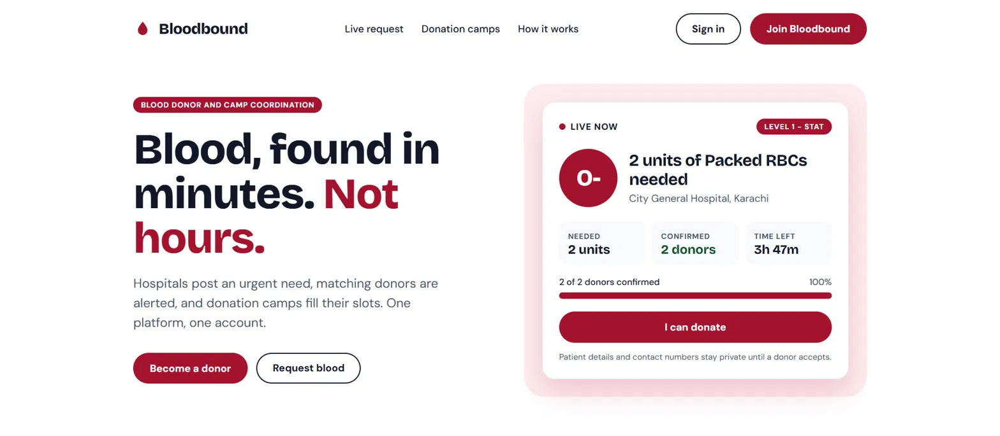
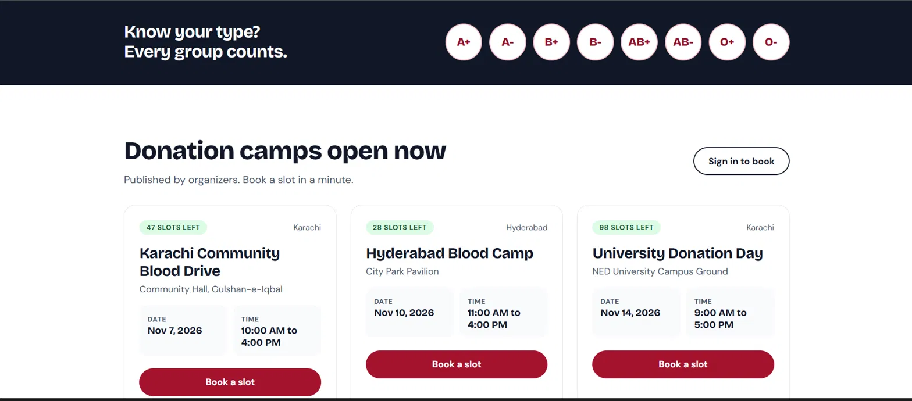
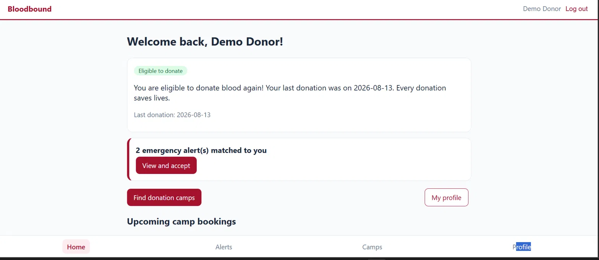
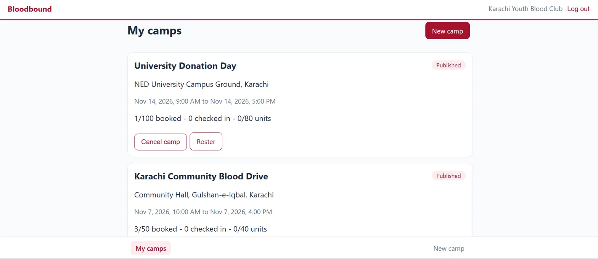
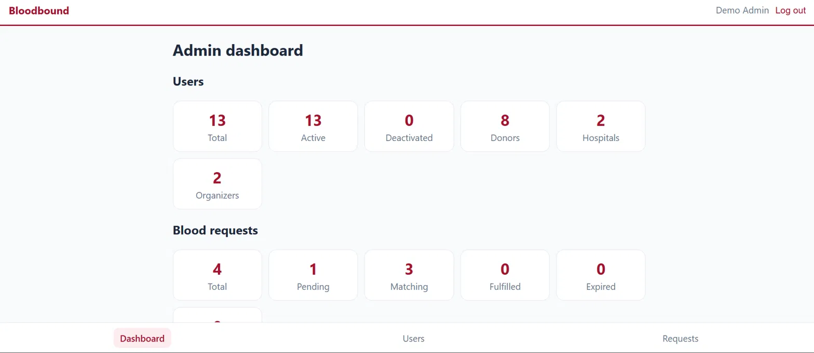
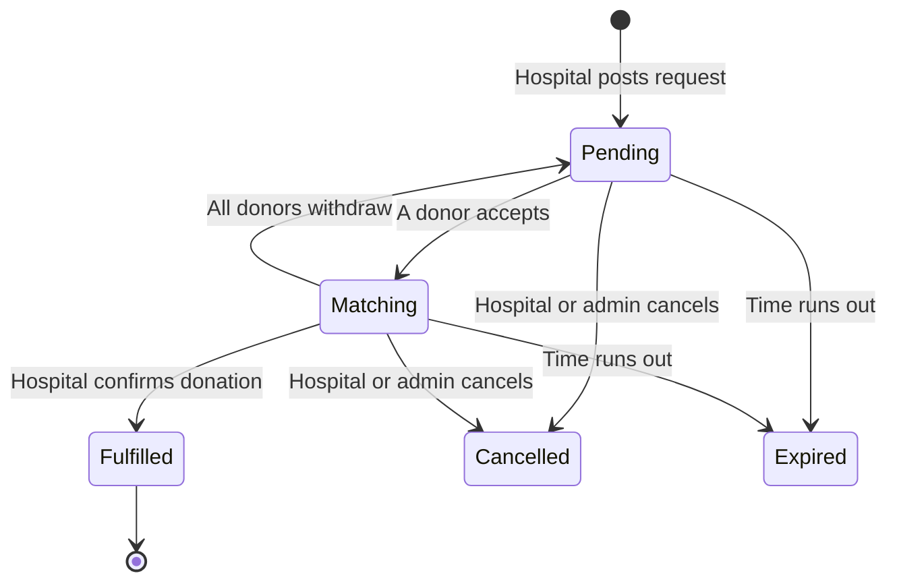
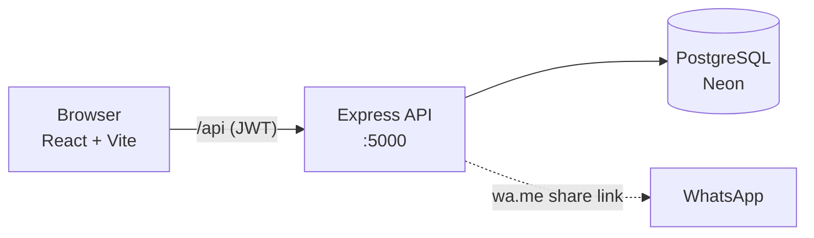

<div align="center">

# 🩸 Bloodbound

### Blood Donor and Donation Camp Coordination System

*Blood, found in minutes. Not hours.*


</div>

| | |
|---|---|
| **Course** | Software Engineering (CT-365), Complex Computing Problem |
| **Group** | 02 |
| **Team** | Areeba Ali (TCT-24004, team leader), Rani (TCT-24024), Wajeeh Ul Hassan(TCT-24031) |
| **Institution** | Thar Institute of Engineering, Sciences and Technology (TIEST), a constituent college of NED University |
| **Repository** | https://github.com/AreebaAliSiddiqui/Bloodbound |
| **Tracking** | Jira board, project `SCRUM` |

---

## Table of contents

1. [What is Bloodbound?](#what-is-bloodbound)
2. [Features](#features)
3. [Screenshots](#screenshots)
4. [How it works](#how-it-works)
5. [Tech stack and architecture](#tech-stack-and-architecture)
6. [Folder structure](#folder-structure)
7. [Getting started](#getting-started)
8. [Demo accounts and mock data](#demo-accounts-and-mock-data)
9. [Business rules](#business-rules)
10. [API reference](#api-reference)
11. [Testing](#testing)
12. [Deliverables](#deliverables)
13. [Conventions and workflow](#conventions-and-workflow)
14. [Known limitations](#known-limitations)

---

## What is Bloodbound?

When a patient needs blood urgently, families often rely on phone chains and group chats. Bloodbound replaces that with one platform:

- **Hospitals** post an urgent blood request in seconds.
- **Eligible, compatible donors** in the same city are alerted automatically.
- **Donors** accept, get the hospital details, and donate. Their next eligible date is tracked for them.
- **Camp organizers** publish donation camps that donors can book, then check donors in and record donations on the day.
- **Admins** keep the platform clean by managing users and moderating fake or abusive requests.

There are no separate portals. There is **one website and one sign-in**, and the app opens the workspace that matches the account's role.

## Features

| Role | What they can do |
|---|---|
| **Visitor** (not signed in) | See the live urgent request, browse open donation camps, learn how it works, sign in or register |
| **Donor** | Home dashboard with eligibility and reminders, emergency alerts (accept or withdraw), camp discovery with city filter, slot booking and cancellation, profile management |
| **Hospital staff** | Create emergency requests (blood group, component, units, urgency), see matched and accepted donors, one-tap **WhatsApp share**, cancel, mark fulfilled |
| **Camp organizer** | Create, edit, publish and cancel camps, live dashboard (booked, checked in, units collected), roster with check-in and donation recording |
| **Admin** | Platform dashboard, user search with deactivate and reactivate, request moderation (expire or remove), camp monitoring |

**Highlights**

- Automatic donor matching by blood compatibility, city and eligibility
- Donor contact details stay private until the donor accepts
- Configurable donation-gap eligibility (56 days by default) with "eligible again" reminders
- Requests expire automatically (4, 12 or 24 hours depending on urgency)
- Camp capacity limits enforced safely under concurrent bookings
- Blood inventory with component-specific expiry (for example, whole blood 35 days, platelets 5 days)
- Public landing page showing the real live request and real open camps

## Screenshots

### Public landing page
The homepage shows the real live request straight from the database: blood group, units, hospital, confirmed donors and time left. Patient details stay private.



### Donation camps open now
Published camps appear for everyone, with real dates, times and slots left.



### Donor workspace
After signing in, a donor sees their eligibility, matched emergency alerts and upcoming bookings.



### Camp organizer workspace
Organizers manage their camps, with live booking, check-in and unit counts, and open the roster on the day.



### Admin dashboard
Admins get platform-wide statistics for users, blood requests and camps, plus user and request moderation.



## How it works



1. **Request:** hospital staff choose blood group, component, units (1 to 10) and urgency.
2. **Match:** the system alerts every compatible, eligible donor in the city.
3. **Accept:** a donor accepts and unlocks the hospital address and phone number.
4. **Donate:** the hospital marks the request fulfilled, and each donor's last donation date and next eligible date update automatically.

Camps follow their own life cycle: `Draft → Published → Ongoing → Completed` (or `Cancelled`).

## Tech stack and architecture

| Layer | Technology |
|---|---|
| Front end | React (Vite), React Router, plain CSS |
| Back end | Node.js, Express, JWT authentication (24 h), bcrypt password hashing |
| Database | PostgreSQL, hosted on Neon |
| Testing | Node's built-in test runner (`node --test`) |
| Workflow | Git and GitHub, Jira (Scrum sprints) |



PostgreSQL was chosen for strict relational integrity between donors, camps, bookings and hospital requests. In development, Vite proxies `/api` to the Express server.

## Folder structure

```text
Bloodbound/
├── README.md
├── Proposal/        D1  Proposal and feasibility
├── SRS/             D2  SRS, requirements, user stories, specs, wireframes
├── Design/          D3  ER diagram, architecture decisions, tech stack
│   └── screenshots/    Application screenshots used in this README
├── SourceCode/      D4  Implementation
│   ├── backend/        Express API
│   │   ├── routes/        auth, donors, requests, camps, bookings, attendance, admin, public
│   │   ├── services/      matching, camp status
│   │   ├── utils/         eligibility, compatibility, WhatsApp
│   │   ├── middleware/    JWT auth and role checks
│   │   ├── database/      schema.sql, migrations, seed.sql
│   │   └── scripts/       reset-database.js, load-mock-data.js
│   └── frontend/       React app (src/pages, src/Layout.jsx, src/api.js)
├── Tests/           D5  Automated test files
├── TestReports/     D5  Test reports, defect log, test case register
├── InputData/       Mock data (mock-data.json)
├── FinalReport/     D6  Final report
└── Presentation/    D6  Slides
```

## Getting started

### Prerequisites

- Node.js 18 or newer
- A PostgreSQL database (a free Neon project works well)
- Git

### 1. Clone

```bash
git clone https://github.com/AreebaAliSiddiqui/Bloodbound.git
cd Bloodbound
```

### 2. Set up the database

Run `SourceCode/backend/database/schema.sql`, then the files in `database/migrations/` in numeric order (`002` to `006`), against your PostgreSQL database using `psql` or your provider's SQL editor.

### 3. Configure and start the back end

```bash
cd SourceCode/backend
npm install
cp .env.example .env      # on Windows: copy .env.example .env
# edit .env: add your database connection string, a JWT secret and the port
node server.js            # API on http://localhost:5000
```

Check it is alive: `http://localhost:5000/api/health`

### 4. Start the front end

```bash
cd SourceCode/frontend
npm install
npm run dev               # opens on http://localhost:5173
```

### 5. Load demo data (optional but recommended)

```bash
cd SourceCode/backend
node scripts/reset-database.js --yes     # deletes ALL existing data
node scripts/load-mock-data.js           # needs the API running
```

> ⚠️ `reset-database.js` wipes every user and everything linked to them in the database named in `.env`. Check which database you are pointing at first.

## Demo accounts and mock data

`InputData/mock-data.json` holds the demo users, blood requests, camps, bookings and acceptances. The loader creates users directly, and everything else through the real API so matching, eligibility and capacity rules all run.

All demo accounts use the password **`Demo@1234`**.

| Role | Email |
|---|---|
| Admin | `admin.demo@bloodbound.org` |
| Hospital staff | `hospital.demo@bloodbound.org` (Karachi), `hyd.hospital.demo@bloodbound.org` (Hyderabad) |
| Camp organizer | `organizer.demo@bloodbound.org` (Karachi), `hyd.organizer.demo@bloodbound.org` (Hyderabad) |
| Donor | `donor.demo@bloodbound.org` (O-, Karachi), plus `ayesha.donor`, `bilal.donor` (recently donated, not eligible), `sana.donor`, `hamza.donor`, `mehak.donor`, `usman.donor`, `zara.donor` at `@bloodbound.org` |

Tip: use a normal window and a private window to be signed in as two roles at once.

## Business rules

- **Roles:** donor, hospital staff, camp organizer and admin. Admin accounts cannot self-register.
- **Eligibility:** calculated from the last donation date with a configurable gap (56 days by default). Ineligible donors are not matched and cannot accept or book.
- **Urgency and expiry:** Critical (Level 1, Stat) expires in 4 h, High (Level 2, Urgent) in 12 h, Normal (Routine) in 24 h.
- **Requests:** 1 to 10 units. Accepted donors cannot exceed the units required.
- **Camps:** name 5 to 100 characters, capacity 10 to 1000, start time in the future. Only Published or Ongoing camps can be booked.
- **Bookings:** one per donor per camp, capacity enforced with row locking, cancellable only before the slot.
- **Privacy:** patient details and contact numbers are never public. The public endpoints expose only non-sensitive fields.
- **Moderation:** admins can expire or remove requests and deactivate users (with a reason). Deactivated users cannot sign in.

## API reference

Base URL: `http://localhost:5000/api`. All routes except those marked **public** require `Authorization: Bearer <token>`.

<details>
<summary><b>Show all endpoints</b></summary>

| Area | Method and path | Role | Purpose |
|---|---|---|---|
| Auth | `POST /auth/register` | public | Create an account |
| Auth | `POST /auth/login` | public | Get a JWT, role and name |
| Public | `GET /public/camps` | public | Open camps for the landing page |
| Public | `GET /public/live-request` | public | Most urgent open request, no private data |
| Donor | `GET /donors/me`, `PUT /donors/me` | donor | View and update profile |
| Donor | `GET /donors/me/eligibility`, `/me/reminders` | donor | Eligibility and reminder message |
| Requests | `POST /requests`, `GET /requests` | hospital | Create and list own requests |
| Requests | `GET /requests/:id` | hospital | Detail with accepted donors |
| Requests | `PUT /requests/:id/cancel`, `/fulfill` | hospital | Cancel or confirm donation |
| Requests | `GET /requests/alerts` | donor | Requests matched to me |
| Requests | `POST /requests/:id/accept`, `/withdraw` | donor | Accept or withdraw |
| Requests | `GET /requests/:id/share/whatsapp` | any user | WhatsApp message and link |
| Camps | `GET /camps` | any user | Discover open camps (`?city=`) |
| Camps | `GET /camps/mine`, `POST /camps` | organizer | Own camps, create camp |
| Camps | `PUT /camps/:id`, `/publish`, `/cancel` | organizer | Edit, publish, cancel |
| Camps | `GET /camps/:id/dashboard` | organizer | Bookings, check-ins, units |
| Bookings | `POST /bookings`, `GET /bookings/mine` | donor | Book a slot, list bookings |
| Bookings | `DELETE /bookings/:camp_id` | donor | Cancel a booking |
| Attendance | `GET /attendance/camps/:id/roster` | organizer | Donors who booked |
| Attendance | `POST /attendance/camps/:id/checkin`, `/donation` | organizer | Check in, record donation |
| Admin | `GET /admin/dashboard`, `/users`, `/users/:id` | admin | Statistics and user management |
| Admin | `PUT /admin/users/:id/deactivate`, `/reactivate` | admin | Control account access |
| Admin | `GET /admin/requests`, `/camps` | admin | Monitor requests and camps |
| Admin | `PUT /admin/requests/:id/expire`, `/remove` | admin | Moderate requests |
| System | `GET /health` | public | Health check |

</details>

## Testing

The back end has **106 automated tests, all passing**, plus manual test scenarios documented per feature.

```bash
# from the repository root, with the database configured
node --test --test-concurrency=1 "Tests/*.test.js"
```

| Where | What |
|---|---|
| `Tests/` | One test file per feature (auth, donors, eligibility, reminders, requests, matching, accept, WhatsApp, camps, booking, attendance, admin, defects) |
| `TestReports/SCRUM-xx-*.md` | One report per ticket with test cases, expected results and outcomes |
| `TestReports/test-case-register.md` | Every test case in one place |
| `TestReports/automated-test-run-*.md` | Full regression summary |
| `TestReports/defect-log.md` | Defects found, cause, fix and retest |

## Deliverables

| Deliverable | Folder | Contents |
|---|---|---|
| D1 | `Proposal/` | Proposal and feasibility |
| D2 | `SRS/` | SRS, requirements, user stories, traceability matrix, specs, wireframes, UML diagrams, sprint notes |
| D3 | `Design/` | ER diagram, domain model, schema, architecture decisions |
| D4 | `SourceCode/` | Back end and front end |
| D5 | `Tests/`, `TestReports/` | Test files, reports, defect log |
| D6 | `FinalReport/`, `Presentation/` | Final report and slides |

## Conventions and workflow

- **Commits** follow Conventional Commits with the Jira ticket, for example `feat(SCRUM-35): add donor slot booking with capacity limits`. Types used: `feat`, `fix`, `test`, `docs`, `chore`, `style`.
- **Branches:** work happens on feature or documentation branches and is merged into `main`.
- **Tracking:** every task is a ticket on the Jira board (project `SCRUM`), planned in sprints with a review and retrospective each sprint.
- **Documents** are submitted as PDF, named `SE_CCP_Group02_Bloodbound`.

## Known limitations

- No password reset or change-password screen.
- The admin camps list exists in the API but has no screen in the app.
- Hospital, organizer and admin accounts cannot edit their profile details in the app.
- The interface was designed and checked on desktop; phone layout is basic.
- WhatsApp sharing opens a pre-filled message link. Nothing is sent automatically.

---

<div align="center">

Built by **Areeba Ali** and **Rani** for Software Engineering (CT-365), Group 02.

*Every donation is someone's second chance.*

</div>
