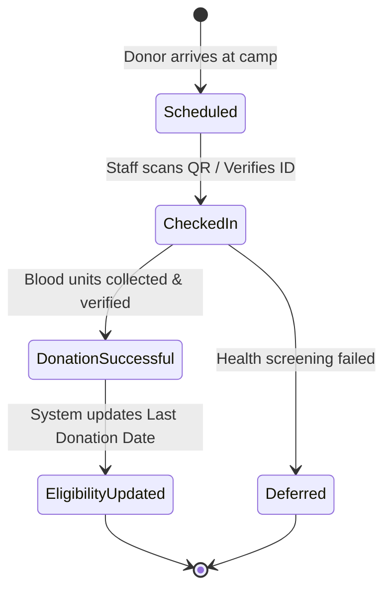

# Attendance & Donation Recording Specification - Bloodbound (Task 36)

## 1. Overview & Objectives
The Attendance and Donation Recording module allows Camp Organizers and Medical Staff to check in registered donors, record successful blood donations, and automatically recalculate donor eligibility dates post-donation.

---

## 2. Attendance & Collection Data Attributes

| Field Name | Type | Validation / Constraints | Required | Description |
| :--- | :--- | :--- | :--- | :--- |
| **Record ID** | UUID | Auto-generated primary key | System | Unique transaction identifier |
| **Donor ID** | UUID | Foreign key to Donor Profile | Yes | Identifier of attending donor |
| **Camp / Request ID**| UUID | Foreign key to Event/Request | Yes | Associated drive or emergency request |
| **Check-in Status** | Enum | Booked, Checked-In, No-Show | System | Live status at event venue |
| **Units Collected** | Decimal | Standard unit volume (e.g., 450 ml) | Yes | Amount of blood successfully drawn |
| **Donation Date** | Timestamp | Auto-captured server time | System | Timestamp for next eligibility calculation |
| **Attending Staff** | String | Registered Medical Staff ID | Yes | Verifying healthcare worker |

---

## 3. Attendance Recording Workflow

---

## 4. Key Business Logic Rules
* **Eligibility Auto-Update:** Recording a successful donation instantly updates the donor's `Last Donation Date` in their profile and sets their next eligible date (+90 days).
* **Digital Donation Certificate:** System automatically generates a digital certificate/pass upon completion of the donation process.
* **No-Show Tracking:** Unattended slots automatically update to `No-Show` status after event conclusion to release reserved metrics.
