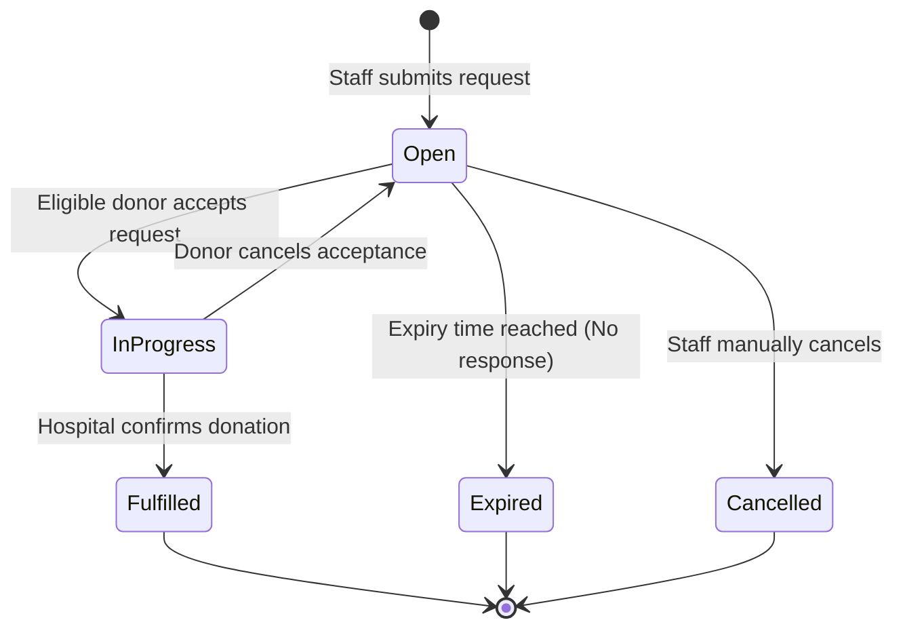

# Emergency Blood Request Specification - Bloodbound (Task 29)

## 1. Overview & Objectives
The Emergency Blood Request module empowers Hospital Staff to create urgent requests for blood units and enables eligible donors to view, respond, and fulfill requests in real-time.

---

## 2. Request Data Fields & Validation Rules

| Field Name | Type | Validation / Constraints | Required | Description |
| :--- | :--- | :--- | :--- | :--- |
| **Request ID** | UUID | Auto-generated primary key | System | Unique identifier for tracking |
| **Patient Blood Group** | Enum | A+, A-, B+, B-, AB+, AB-, O+, O- | Yes | Target blood group needed |
| **Required Units** | Integer | Min: 1, Max: 10 units | Yes | Quantity of blood units requested |
| **Hospital Location** | String / Geo | Address string + GPS coordinates | Yes | Destination for donor arrival |
| **Urgency Level** | Enum | Critical (2-4 hrs), High (6-12 hrs), Normal | Yes | Determines notification priority |
| **Status** | Enum | Open, In-Progress, Fulfilled, Expired, Cancelled | System | Current lifecycle state |
| **Expiry Time** | Timestamp | Auto-calculated (Default: 24 hrs from creation) | System | Time after which alert auto-expires |

---

## 3. Request Lifecycle State Machine

---

## 4. Key Functional Features
* **Auto-Matching Engine:** Triggered immediately upon request creation to notify donors within a defined geographic radius.
* **Auto-Expiry Handler:** Background job that automatically transitions `Open` or `In-Progress` requests to `Expired` once the target timestamp is breached.
* **Status Dashboard:** Provides real-time view of active requests, accepted donors, and pending unit requirements for hospital personnel.
