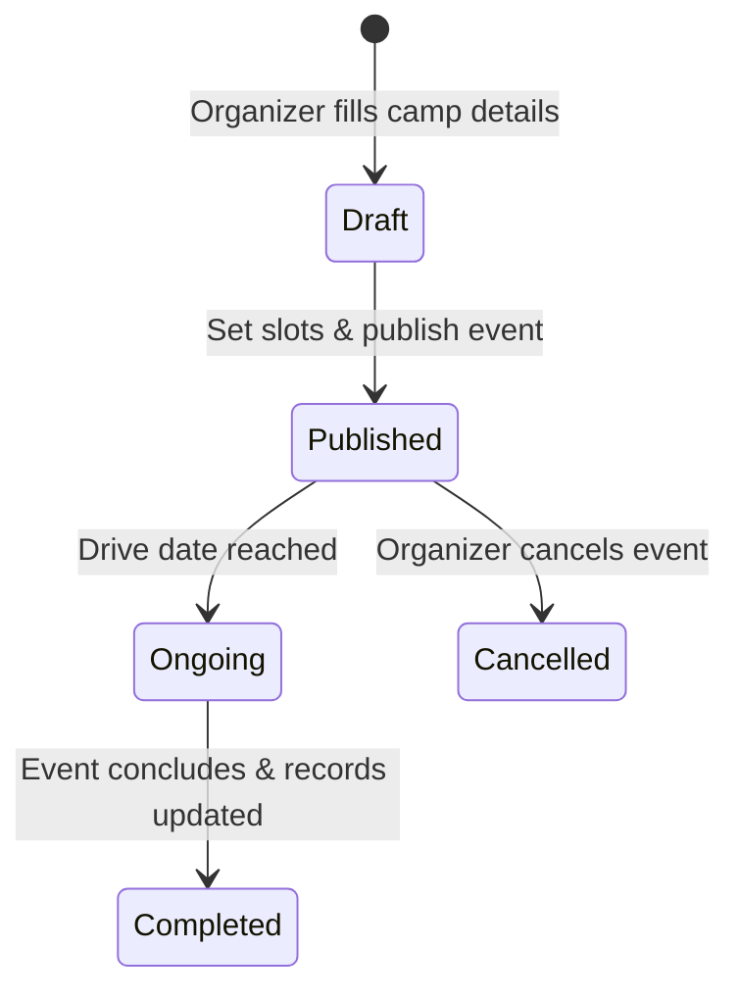

# Donation Camp Management Specification - Bloodbound (Task 34)

## 1. Overview & Objectives
The Camp Management module allows Camp Organizers and Authorized Partners to organize, schedule, and publish blood donation drives. It enables donors to discover upcoming camps and pre-book attendance slots.

---

## 2. Camp Data Attributes & Validation

| Field Name | Type | Validation / Constraints | Required | Description |
| :--- | :--- | :--- | :--- | :--- |
| **Camp ID** | UUID | Auto-generated primary key | System | Unique identifier |
| **Camp Title** | String | Min 5 chars, Max 100 chars | Yes | Event title (e.g., City Center Drive) |
| **Organizer Name** | String | Registered Organizer ID | Yes | Entity managing the camp |
| **Location & Address**| String / Geo | Address + Map Coordinates | Yes | Physical location of the drive |
| **Drive Date & Time** | DateTime | Future date only | Yes | Event start and end time |
| **Max Capacity** | Integer | Min: 10, Max: 1000 | Yes | Total donor slot limit |
| **Status** | Enum | Draft, Published, Ongoing, Completed, Cancelled | System | Event lifecycle status |

---

## 3. Camp Creation & Publishing Flow

---

## 4. Key Functional Features
* **Slot Capacity Controller:** Automatically updates available booking counts when donors reserve or cancel slots.
* **Organizer Dashboard:** Provides live donor registration counts, checked-in status, and donation metrics during the event.
* **Geographic Event Discovery:** Displays upcoming donation camps to nearby donors on an interactive map and list view.
