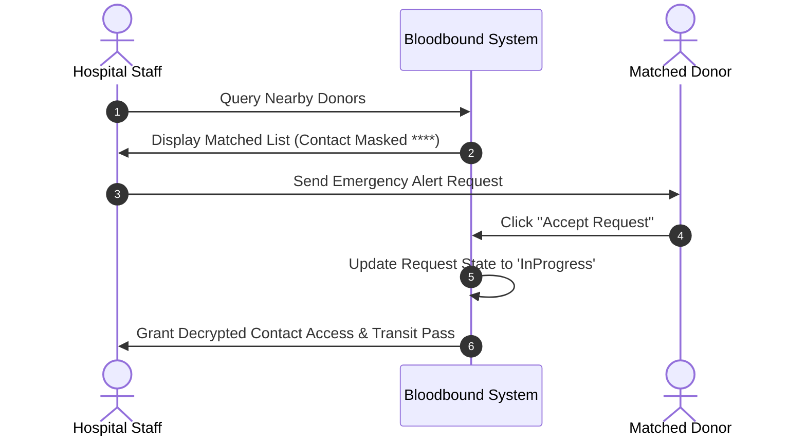

# Donor Privacy & Contact Masking Specification - Bloodbound (Task 31)

## 1. Overview & Objectives
To protect donor privacy and prevent unsolicited communications, personal contact information (such as phone numbers and exact street address) remains completely masked until the donor explicitly accepts an emergency blood request or confirms a camp donation slot.

---

## 2. Privacy & Access Control Logic

| Lifecycle State | Hospital / Requester Access | Donor Contact Visibility | System Action |
| :--- | :--- | :--- | :--- |
| **Request Broadcasted** | Can view total matched donors count & distance radius | Masked (`XXXXXX-1234` / Hidden) | Notifications sent via System Gateway |
| **Donor Accepts Request** | Unlocks full contact details & digital transit pass | Fully Visible to Assigned Hospital Staff | Direct SMS/Call option enabled in app |
| **Request Completed / Cancelled** | Access revoked after 24 hours | Masked / Archived in logs | Contact details hidden again |

---

## 3. Privacy Data Flow

