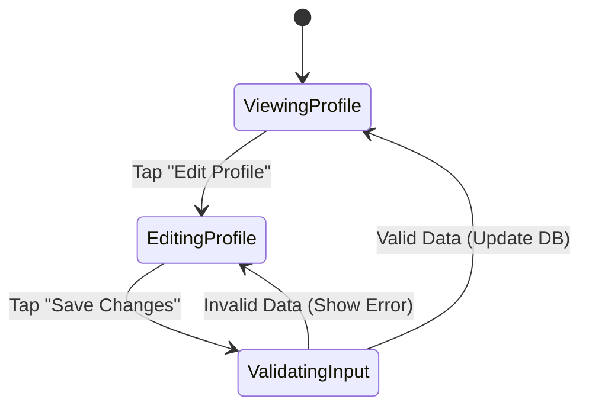

# Donor Profile Specification - Bloodbound (Task 28)

## 1. Overview & Objectives
The Donor Profile module allows registered donors to manage their personal, contact, and biological details required for emergency donor matching and camp slot bookings.

---

## 2. Profile Data Fields
The profile system maintains the following essential fields:

| Field Name | Type | Options / Validation | Required | Description |
| :--- | :--- | :--- | :--- | :--- |
| **Full Name** | String | Standard text | Yes | Donor's display name |
| **Blood Group** | Enum | A+, A-, B+, B-, AB+, AB-, O+, O- | Yes | Used for compatibility matching |
| **City / Area** | String / Geo | Dropdown / Geolocation pin | Yes | Used for distance-based alerts |
| **Last Donation Date** | Date | YYYY-MM-DD (Past dates only) | Optional | Determines immediate eligibility |
| **Availability Status**| Boolean | Active / Inactive toggle | Yes | Allows donors to pause alerts |

---

## 3. Eligibility & Business Logic Rules
* **Cooldown Period:** A donor becomes eligible 90 days after their `Last Donation Date`.
* **Profile Completeness:** Blood Group and City/Location must be filled before a donor can accept emergency requests.

---

## 4. Profile Screen Interaction Flow

