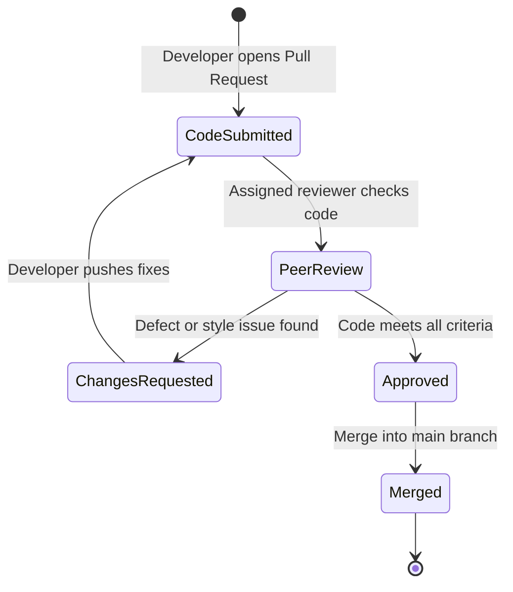

# Peer Code Review Specification & Log - Bloodbound (Task 16)

## 1. Overview & Review Objectives
The Peer Code Review process ensures that all modules developed across Sprint 1 and Sprint 2 adhere to coding standards, security best practices, and maintainability guidelines before final integration and deployment.

---

## 2. Review Checklist & Criteria
* **Code Structure & Readability:** Clean naming conventions, modular architecture, and proper indentation.
* **Security & Validation:** Input sanitization, protection against SQL injection, and phone number masking verification.
* **Error Handling:** Proper try-catch blocks and graceful failure responses for API calls.
* **Documentation:** Adequate comments and alignment with SRS module specifications.

---

## 3. Peer Review Log & Sign-off

| Review ID | Module / File Reviewed | Reviewer | Author | Status / Findings | Action Taken |
| :--- | :--- | :--- | :--- | :--- | :--- |
| **PR-01** | Donor Profile & Privacy API | Rani | Areeba | Approved; masking logic verified | None |
| **PR-02** | Camp Management & Slot Controller | Areeba | Rani | Approved; capacity validation checked | Minor boundary check added |
| **PR-03** | Attendance & Donation Recording | Rani | Areeba | Approved; date logic correct | None |
| **PR-04** | WhatsApp Share Link Integration | Areeba | Rani | Approved; URL encoding verified | None |

---

## 4. Code Review Workflow

