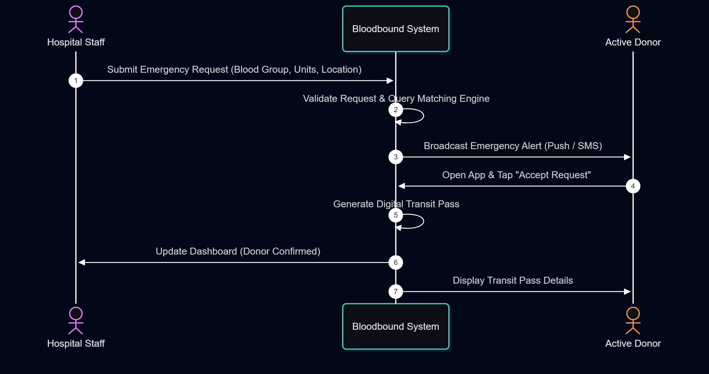
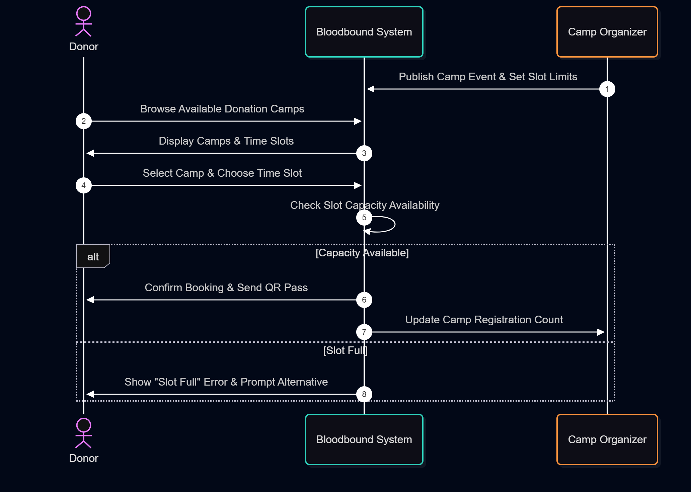

# Sequence Diagrams - Bloodbound

## 1. Emergency Blood Request & Donor Matching Sequence
This sequence illustrates the interaction between Hospital Staff, the System, and Donors during an emergency blood request.

---

## 2. Donation Camp Slot Pre-Booking Sequence
This sequence illustrates how a Donor browses and books a time slot for a donation camp.

