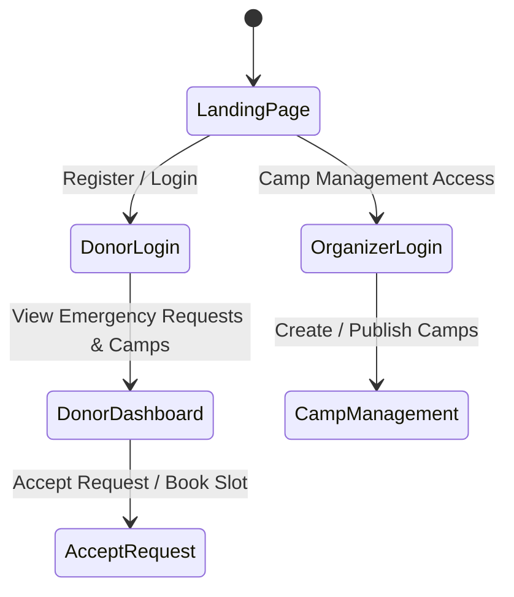

# Setup Instructions & User Guide - Bloodbound (Task 40)

## 1. System Requirements & Setup Instructions
To run and deploy the Bloodbound system locally or on a staging server, follow these prerequisites:
* **Node.js:** Version 18.x or higher
* **Database:** PostgreSQL / MySQL configured with the relational schema (`ExpenseTrackerDB` / Bloodbound tables)
* **Environment Variables:** Set up `.env` with database connection strings and API keys.

### Installation Steps:
1. Clone the repository: `git clone https://github.com/AreebaAliSiddiqui/BloodBound.git`
2. Navigate to the source folder and install dependencies: `npm install`
3. Run database migrations and seed initial data.
4. Start the development server: `npm run dev`

---

## 2. User Guide & Navigation Flow

---

## 3. Key End-User Workflows
* **For Donors:** Register profile, check eligibility status, receive emergency broadcast alerts, and accept requests to unmask contact details.
* **For Organizers:** Create donation camp drives, manage slot limits, record live attendance, and track successful blood collections.
* **For Admins:** Moderate user registrations, oversee system analytics, and manage platform safety guidelines.
