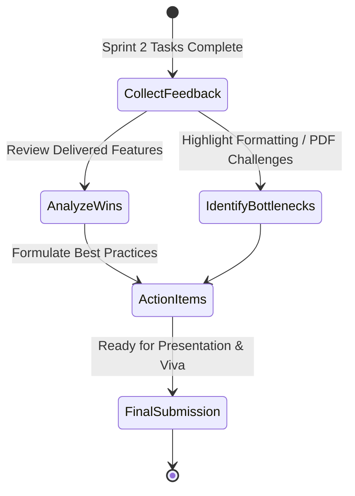

# Sprint 2 Review & Retrospective Notes - Bloodbound (Task 15)

## 1. Overview & Sprint Goal
The primary focus of Sprint 2 was finalizing core functional modules (Camp Management, Attendance Recording, WhatsApp Sharing, Privacy Controls), executing test plans, and consolidating full SRS documentation.

---

## 2. Sprint Review Summary (What Was Delivered)
* **Camp & Attendance Modules:** Completed specs for camp creation, capacity limits, and donor check-ins.
* **Privacy Controls:** Detailed unmasking workflows upon donor acceptance.
* **Testing & Quality Assurance:** Formulated test cases, execution strategy, and peer code review procedures.
* **User & Setup Documentation:** Completed setup guides and viva/presentation preparation outlines.

---

## 3. Retrospective Analysis

### What Went Well (Wins)
* Excellent progress on Markdown and Mermaid.js diagram standardization across all deliverables.
* Smooth reallocation and completion of assigned documentation tasks ahead of target dates.

### What Could Be Improved
* Initial setup for state diagrams required minor formatting adjustments to avoid rendering issues.
* PDF compilation across varied operating systems needed centralized coordination.

---

## 4. Retrospective Flow

