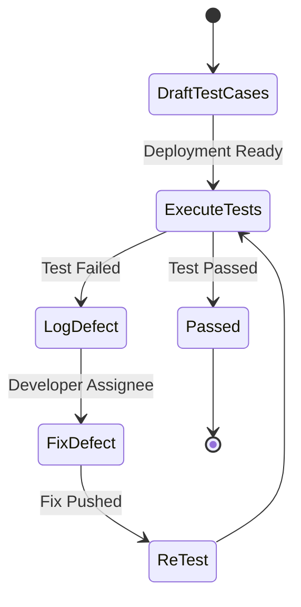

# Test Plan & Test Cases Specification - Bloodbound (Task 38)

## 1. Overview & Testing Strategy
This document outlines the testing scope, methodology, and key test cases for validating the Bloodbound application. The goal is to ensure data security, accurate donor matching, and seamless camp bookings.

---

## 2. Testing Types & Scope
* **Unit Testing:** Core algorithms (Eligibility calculation, compatibility matrix).
* **Integration Testing:** Emergency alert triggers and database record updates.
* **UI/UX Testing:** Responsiveness across screen resolutions and accessibility.
* **Security Testing:** Role-based access controls and phone number masking verification.

---

## 3. Key Test Cases

| Test Case ID | Feature / Module | Test Scenario | Input / Action | Expected Result | Pass/Fail |
| :--- | :--- | :--- | :--- | :--- | :--- |
| **TC-01** | Authentication | Register donor with valid details | Submit signup form | Account created & redirected to dashboard | Pending |
| **TC-02** | Eligibility | Donor donated 30 days ago | Check eligibility status | System displays "Ineligible" with remaining days | Pending |
| **TC-03** | Privacy | Emergency request broadcasted | View matched donor list | Donor phone number appears as masked `****` | Pending |
| **TC-04** | Privacy | Donor accepts request | Tap "Accept Request" | Full contact details unmasked for hospital staff | Pending |
| **TC-05** | Camp Booking | Book fully occupied slot | Select full time slot | Booking disabled with "Slot Full" message | Pending |

---

## 4. Test Execution Flow

