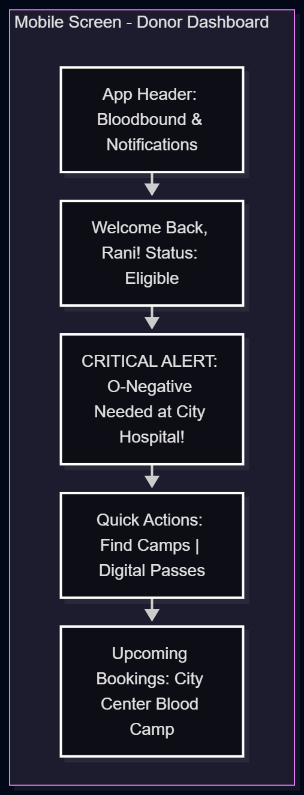
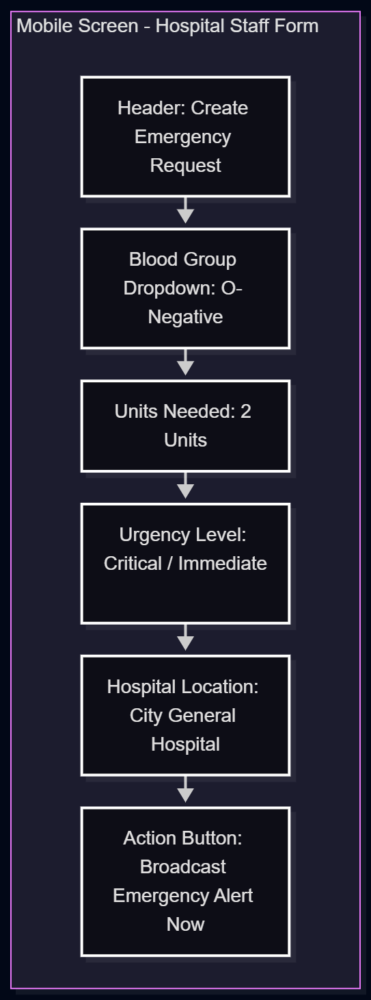
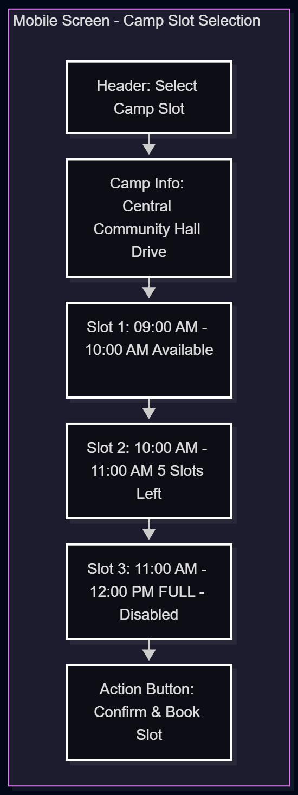

# UI Wireframes & Layout Guidelines - Bloodbound

## 1. Design Principles & Navigation Structure
The Bloodbound user interface follows a clean, accessible, and high-contrast design system optimized for urgent emergency actions and smooth camp bookings.
- **Primary Color Palette:** Crimson Red (#DC2626) for emergency accents, Clean White background, and Slate Gray text for readability.
- **Bottom Navigation Bar (Mobile View):** Home, Search/Camps, Emergency Alerts, Profile.

---

## 2. Core Screen Wireframes

### Screen 1: Donor Dashboard (Home)
Below is the dashboard view for an authenticated donor. It prioritizes urgent emergency requests in their area and provides quick access to donation passes and camp search.

### Screen 2: Emergency Request Submission (Hospital Staff View)
This wireframe shows the form used by Hospital Staff to quickly submit an urgent blood request.

### Screen 3: Donation Camp Slot Booking (Donor View)
This wireframe demonstrates the process where a donor chooses an available time slot to pre-book their donation and generate a QR pass.

