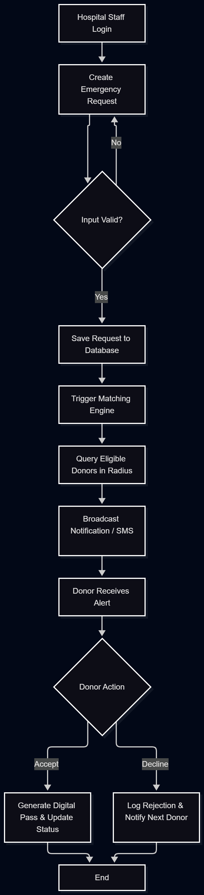

# Use-Case and Activity Diagrams - Bloodbound

## 1. Use-Case Overview
The Bloodbound system supports four primary actors interacting with core modules:
- **Donor:** Registers, updates profile, accepts emergency requests, pre-books camp slots.
- **Hospital Staff:** Submits urgent blood requests, tracks donor responses, monitors inventory.
- **Camp Organizer:** Creates donation camps, manages schedules and slot capacity limits.
- **System Admin:** Moderates accounts, oversees system activity, and monitors audit logs.

---

## 2. Activity Diagram (Emergency Request Flow)
Below is the visual flowchart showing how an emergency blood request flows from submission to donor notification:

