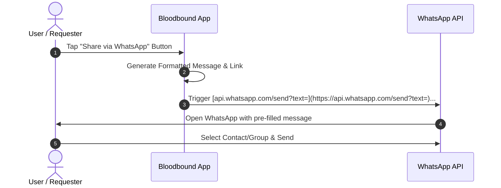

# WhatsApp Share Link Specification - Bloodbound (Task 32)

## 1. Overview & Objectives
The WhatsApp Share module allows users, organizers, and hospitals to instantly broadcast blood requests or donation camp links directly to WhatsApp chats, groups, or status updates to maximize community outreach.

---

## 2. Share Link Architecture & Format

| Component | Specification / Value | Description |
| :--- | :--- | :--- |
| **Base Protocol** | `https://api.whatsapp.com/send?text=` | Standard WhatsApp click-to-chat API |
| **URL Encoding** | UTF-8 Percent-Encoding | Ensures special characters, emojis, and links render correctly |
| **Pre-filled Template** | Dynamic Text Generation | Includes urgency level, blood group, location, and app link |

---

## 3. WhatsApp Sharing Workflow

---

## 4. Key Functional Features
* **Dynamic Template Generation:** Automatically populates critical details (e.g., *"URGENT: B+ blood needed at City Hospital. Tap to view/accept: [Link]"*).
* **Cross-Platform Support:** Works seamlessly across mobile applications (iOS/Android) and web browsers.
* **Low-Priority Integration:** Designed as an auxiliary outreach channel to speed up community response times without altering core database states.
